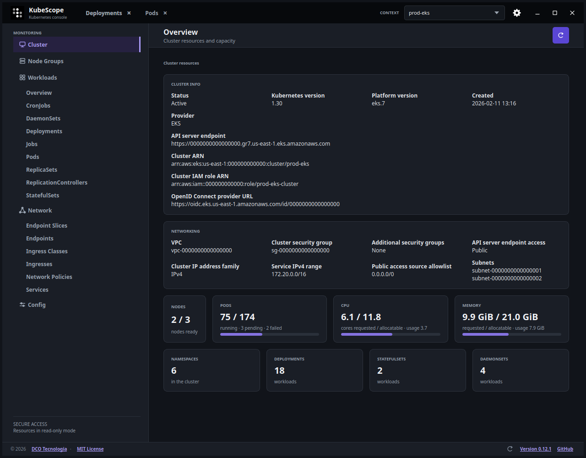

# KubeScope

[](https://github.com/dcotecnologia/kubescope/actions/workflows/ci.yml)
[](https://github.com/dcotecnologia/kubescope/actions/workflows/ci.yml)
[](LICENSE)
[](pyproject.toml)
[](https://doc.qt.io/qtforpython-6/)
[](#packaging)
[](https://docs.astral.sh/ruff/)
[](https://kubernetes.io/)

Desktop IDE for Kubernetes, including Amazon EKS, Google GKE and
Azure AKS clusters available
through the local Kubernetes configuration. It talks to the cluster with the
official Kubernetes Python client, so it needs no `kubectl`. It is read-only by
default: it lists and inspects resources. An optional **write mode** (off until
you turn it on in Settings) adds a few actions to the right-click menu: delete or
evict a Pod, scale or restart a Deployment (each asks for confirmation), and the
complete `kubectl exec` command to open a shell in a Pod and the `kubectl
port-forward` command of a Service, a Pod or a StatefulSet, to run in your own terminal.

## Install

The easiest way, and the one we recommend, is the install script. It finds the
latest release, picks the right package for your system, checks it against the
sha256 that GitHub publishes for it, and installs it. Run the same command again to
update.

**Linux** (the `.deb` on Debian and Ubuntu, the AppImage elsewhere):

```bash
curl -fsSL https://raw.githubusercontent.com/dcotecnologia/kubescope/main/install.sh | sh
```

**Windows** (PowerShell, for your user, no administrator needed):

```powershell
irm https://raw.githubusercontent.com/dcotecnologia/kubescope/main/install.ps1 | iex
```

To choose a version or look before it acts, save the script and run it with
`--dry-run` (`-DryRun` on Windows), `--version 0.1.0` (`-Version 0.1.0`) or
`--method appimage`; `./install.sh --help` lists them. A script that you pipe into a
shell runs with your rights, so read it first if you prefer:
[install.sh](install.sh) and [install.ps1](install.ps1). The sha256 check catches a
damaged or swapped download; it trusts GitHub and this repository, as any download
from them does.

There is no macOS package yet; see [run it from source](#run-from-source).

### Install by hand

Download the package for your system from the
[latest release](https://github.com/dcotecnologia/kubescope/releases/latest). You do
not need `kubectl`.

| System            | Package                                     | How to install                                                                 |
| ----------------- | ------------------------------------------- | ------------------------------------------------------------------------------ |
| Debian and Ubuntu | `kubescope_<version>_amd64.deb`             | `sudo apt install ./kubescope_<version>_amd64.deb`, then `kubescope`           |
| Any Linux         | `KubeScope-<version>-x86_64.AppImage`       | `chmod +x` the file and run it                                                 |
| Any Linux (snap)  | `dco-kubescope_<version>_amd64.snap`        | `sudo snap install dco-kubescope`                                              |
| Linux (Flatpak)   | `KubeScope-<version>.flatpak`               | `flatpak install --user ./KubeScope-<version>.flatpak`                         |
| Windows           | `KubeScope-<version>-windows-x64-setup.exe` | run the installer; or unzip the portable `KubeScope-<version>-windows-x64.zip` |
| macOS and others  | none yet                                    | [run it from source](#run-from-source)                                         |

For the Flatpak and the snap, how to remove the app, and the details of each system, read the
[installation guide](https://github.com/dcotecnologia/kubescope/wiki/Installation)
on the wiki. To connect to your clusters, see
[Connecting to clusters](https://github.com/dcotecnologia/kubescope/wiki/Connecting-to-clusters).



_The cluster overview, shown with sample data. Regenerate it with
`make screenshot`._

## Features

- **Overview:** nodes ready, Pod counts, CPU and memory requests against capacity,
  and the number of namespaces, Deployments, StatefulSets and DaemonSets.
- **Workloads overview:** the first entry of the **Workloads** menu counts Pods,
  Deployments, DaemonSets, StatefulSets, ReplicaSets, Jobs and CronJobs with a
  health bar each (green healthy, orange coming up or degraded, red failing, grey
  idle) and lists the latest cluster events. Each count links to its list.
- **Workloads:** the same menu slides out **Pods**, **Deployments**,
  **StatefulSets**, **DaemonSets**, **ReplicaSets**, **ReplicationControllers**,
  **Jobs** and **CronJobs**.
  - The lists show CPU, memory and restarts next to the status, and can be
    filtered by namespace and searched by name.
  - CPU and memory are live usage from `metrics-server`; without it they show
    `—`. A workload's numbers are the sum of its Pods. Jobs show completions and
    a Complete, Running, Failed or Suspended status; CronJobs show their schedule.
  - In the Pods list, young Pods (under an hour) get a soft green row and Pods
    that are restarting, failing or not ready get a soft red one.
- **Network:** a second menu lists **Services**, **Endpoint Slices**, **Endpoints**,
  **Ingresses**, **Ingress Classes** and **Network Policies**, each with its own
  columns, and **Details** for the JSON of a row. The two menus open on their own,
  and the navigation scrolls when they do not fit.
- **Pinned lists:** double-click any entry of the Workloads, Network or Config
  menus (or right-click it and choose **Pin to the top**) to keep it as a tab in
  the top bar, like Lens, for quick access; middle-click the tab, or click its ×,
  to unpin. The choice is kept in
  `settings.json`.
- **Config:** a third menu lists **Config Maps**, **Secrets**, **Resource Quotas**,
  **Limit Ranges**, **Horizontal Pod Autoscalers**, **Pod Disruption Budgets**,
  **Priority Classes**, **Runtime Classes**, **Leases** and the **Mutating** and
  **Validating Webhook Configurations**. **Details** of a Secret shows its keys,
  never its values. **Add-ons** lists the Helm releases of the cluster and, on Amazon
  EKS, its EKS add-ons.
- **Cluster info (EKS only):** the Overview shows status, Kubernetes and platform
  versions, creation time, API server endpoint and the cluster and IAM role ARNs,
  and a **Networking** card with the VPC, subnets, security groups, endpoint access
  and service range.
- **Node Groups (EKS only):** a main-menu entry under Overview, shown only for
  Amazon EKS contexts. It lists the managed node groups with status, instance
  types, nodes (desired, min and max), AMI type and AMI version, read through the
  AWS CLI, with the cluster's nodes (status, role, version, CPU, memory, Pods) in
  the same view. It has no namespace filter, since node groups are not namespaced.
- **Details and logs:** JSON details of a Pod or workload, and live Pod logs,
  each in its own closable tab, colored like Monokai. **Save...** writes the open
  tab to a file you choose.
- **Assistant:** the round button in the corner of the window opens a chat with a
  coding assistant of your computer (Claude Code is the first; it must be
  installed and signed in). It sees what you see, can read details, logs, lists
  and events to look into a problem, answers in the language of the app, and
  moves the window for you: a list, a page, a tab, the logs of a Pod. It never
  changes a cluster by itself: a change is a card with **Run**, available only
  with the write mode on. Attach images and text files, resize the panel, or take
  it out into a window of its own; conversations are kept for each context.
  Nothing is sent until you open the chat and agree, and **Settings** turns it
  off. What goes where is in [SECURITY.md](SECURITY.md).
- **Update check:** when it starts, KubeScope asks GitHub for the latest release
  and shows **Update available** next to an icon in the footer. The icon spins
  while it looks, and clicking it checks again. It sends only the app version;
  **Settings** turns the startup check off. Clicking **Update available** asks you
  to confirm, shows the version change and the release notes, then updates the
  way KubeScope was installed (AppImage, `.deb` or the Windows installer) and
  restarts it. A Flatpak, a snap or a source checkout opens the release page instead; the Flatpak
  and the snap are updated by their stores.
- **Your table, your way:** drag any column border to resize it, and right-click
  a table header to hide or show columns. The choice is remembered.
- **Readable errors:** a missing login tool, an unreachable cluster, expired
  credentials or denied access appear as a short message with a hint; the
  original error text stays one click away as details.
- **Sign-in check:** when you open an AWS context, KubeScope checks that you are
  signed in (SSO session or access keys). If not, a **Sign in to AWS** button
  runs `aws sso login` for the profile your kubeconfig uses and reloads the data.
  Access-key profiles get a **Configure AWS credentials** button that opens a
  terminal with `aws configure` for that profile. Google GKE and Azure AKS
  contexts get a **Sign in to Google Cloud** button (`gcloud auth login`) or a
  **Sign in to Azure** button (`az login`) when their credentials have expired.
- **Windows and lists rise into place** as they first show; **Settings** turns the
  animations off.
- **Always responsive:** every cluster call runs in the background, so the window
  never freezes while the cluster or the cloud CLIs work.
- **English, Portuguese, Spanish, Italian, French, German, Dutch, Polish, Turkish,
  Indonesian, Vietnamese, Ukrainian, Russian, Chinese (simplified and traditional),
  Japanese, Korean, Thai, Hebrew, Persian, Arabic and Hindi**,
  selectable in Settings, where each language is listed by its own name and its English
  name, in alphabetical order.

## Requirements

- Python 3.12 or newer to run from source
- Linux Mint/Ubuntu: `apt-get` and `dpkg-deb` to stage the Qt XCB runtime library
- For contexts whose kubeconfig signs in with an `exec` credential plugin: the
  AWS CLI (EKS), `gke-gcloud-auth-plugin` and the Google Cloud CLI (GKE), or
  `kubelogin` and the Azure CLI (AKS), and valid credentials for them
- Read access to namespaces, pods, events, deployments, statefulsets, daemonsets,
  replicasets, replicationcontrollers, jobs, and cronjobs; for the Network menu,
  also services, endpoints, endpointslices, ingresses, ingressclasses, and
  networkpolicies; for the Config menu, also configmaps, secrets, resourcequotas,
  limitranges, horizontalpodautoscalers, poddisruptionbudgets, priorityclasses,
  runtimeclasses, leases, and the mutating and validating webhook configurations
- Optional, for the cluster overview page: read access to nodes and pods across
  namespaces. Optional, for CPU and memory in the Pods and Deployments lists and
  on the overview: `metrics-server` for real usage. Sections the role
  cannot read are reported on the page instead of failing it

## Run from source

```bash
make setup                      # uv sync with the dev and build extras
uv run pre-commit install       # run the checks on every commit
make run
```

`make run` stages `libxcb-cursor.so.0` locally on Linux and adds it to the
runtime library path. This avoids installing `libxcb-cursor0` system-wide. On
non-Linux systems, the target starts the app without the Linux-specific library.

`make debug` runs the app with debug logging on stderr (`KUBESCOPE_DEBUG=1`),
Python dev mode and Qt platform-plugin tracing. Nothing is written to disk.

The app reads contexts from the default kubeconfig (`~/.kube/config` or the path
in `KUBECONFIG`). Unless you turn on the write mode it only reads cluster
resources, so configure a read-only Kubernetes role for the contexts used by the
app. The write mode needs more rights, listed in the wiki.

## Build a bundled application

Build on each target operating system and architecture. PyInstaller includes the
Python dependencies, among them the Kubernetes client, in the application bundle.

```bash
python -m pip install -e '.[build]'
python tools/fetch_linux_qt_libs.py  # Linux only
pyinstaller --noconfirm KubeScope.spec
```

The distributable application is created under `dist/KubeScope/`.

## Debug log

**Settings > Debug mode** writes a log file you can share when something goes
wrong: the commands the app ran, how long they took and how they ended, never Pod
logs or resource contents, with tokens and keys scrubbed. **Open the log folder**
jumps to it (`logs/` next to `settings.json`). The file rotates and stays small.
`make debug` also prints the log to the terminal. See [SECURITY.md](SECURITY.md)
for exactly what is recorded.

## Settings, themes and languages

The **Settings** page (sidebar) stores preferences as JSON in
`~/.config/kubescope/settings.json` (`%APPDATA%\\kubescope` on Windows,
`~/Library/Application Support/kubescope` on macOS; override with
`KUBESCOPE_CONFIG_DIR`). It lets you pick the language, the theme, remember the last context, and give each kubeconfig
context a friendlier display name. The real context name is still used for every
request. Hidden table columns are stored in the same file.

### Themes

KubeScope ships a **Light** and a **Dark** theme, and you can make your own. In
Settings, **New theme...** opens an editor that starts from the selected theme: give
it a name, pick a color for each part of the interface (page, panels, top bar,
accent, status colors, and more) and save. **Edit theme...** changes one of your
themes (its **Reset** button undoes the color changes since the editor opened),
and the window follows at once when it is the one in use. **Delete theme...**
removes one you made after asking (the themes that come with the app
cannot be deleted); if it was in use, the Dark theme comes back.

A theme is a small JSON file in the `themes/` folder next to `settings.json` (the
**Open the themes folder** button jumps there), so you can also edit or share it by
hand. It starts from a base theme and lists only the colors it changes:

```json
{
  "name": "Midnight",
  "base": "dark",
  "colors": { "page": "#0b0f14", "accent": "#7aa2f7", "topbar": "#000000" }
}
```

The color names are the ones the editor shows (`page`, `surface`, `text`, `accent`,
`topbar`, `good`, `bad`, ...; see `ROLES` in `src/kubescope/theme.py`). A file that
is damaged or uses an unknown name is skipped and noted in the debug log.

The themes that ship with the app live in `src/kubescope/themes/`, one JSON file
each. Light and Dark (`light.json` and `dark.json`) are built in and read at start;
for each of the others (Midnight, High contrast, Sepia,Dark Modern, Light Modern, Solarized Dark and Light, Monokai,
Tomorrow Night Blue, Abyss and Quiet Light) KubeScope copies the file into your themes folder when it
starts, whenever that file is missing: the first time, and again if you deleted it
from the folder. A file that is there is never overwritten, so your edits are kept.
None of them can be deleted from the app. To share a theme, add its file there and open a pull request
(the folder's README has the steps).

### Languages

KubeScope speaks **English**, **Portuguese** (`pt`), **Spanish** (`es`), **Italian** (`it`),
**French** (`fr`), **Chinese** (`zh`, simplified), **Japanese** (`ja`), **Arabic** (`ar`,
written right to left: the whole layout mirrors), **Hindi** (`hi`), **Russian** (`ru`), **Korean** (`ko`), **German** (`de`), **Turkish**
(`tr`), **Indonesian** (`id`), **Polish** (`pl`), **Vietnamese** (`vi`), **Dutch** (`nl`),
**Ukrainian** (`uk`), **Thai** (`th`), **Chinese (traditional)** (`zh_TW`, also used for
Hong Kong and Macau) and **Hebrew** (`he`) and **Persian** (`fa`), which are written right
to left like Arabic. **Automatic** (the default) follows
your system language and falls back to English. The texts in the code are English;
each other language is a JSON file, `src/kubescope/languages/<code>.json`: a name, whether
it is written right to left, and each English text with its translation. To add a
language without changing the app, or to change a shipped one, put a file of the same
format, named by the language code (`de.json`), in the `languages` folder of your
settings (`~/.config/kubescope/languages` on Linux); it becomes a choice in Settings
after a restart, and a file there wins over the shipped one of the same code.

## Contribute a theme or a language

Both are welcome as pull requests; `make test` checks them, and
[CONTRIBUTING.md](CONTRIBUTING.md) has the general workflow.

### Add a theme

1. In KubeScope, **Settings > New theme...**, pick your colors and save.
2. Copy the file from your themes folder (**Open the themes folder**) into
   `src/kubescope/themes/`, with a short lowercase name such as
   `my-theme.json`.
3. Run `make test`. It checks that every shared theme is valid, uses known color names
   and keeps its text readable (a 4.5:1 contrast between text and page).
4. Open a pull request, ideally with a screenshot. Once merged, the theme ships with
   the app and installs itself in everyone's themes folder.

### Add a language

1. `make language CODE=es NAME=Español` creates `src/kubescope/languages/es.json` with
   every text to translate, each with an empty translation. Use the two-letter
   language code and name the language in itself (add `RTL=1` for one written right
   to left).
2. Fill in the translations in any text editor. Keep the `{placeholders}` as they are.
3. `make test` fails while any text is untranslated (empty).
4. Open a pull request. To fix or improve an existing translation, edit its JSON.

New texts in the code are wrapped in `self.tr(...)`; after adding or changing some, run
`make i18n` to add them to every language file, untranslated, and complete the
translations.

## Packaging

```bash
make build      # PyInstaller bundle in dist/KubeScope
make deb        # dist/kubescope_<version>_amd64.deb (Debian/Ubuntu)
make appimage   # dist/KubeScope-<version>-x86_64.AppImage (any Linux with glibc)
make snap       # dist/dco-kubescope_<version>_amd64.snap (needs snapcraft; Linux x86_64)
make flatpak    # dist/KubeScope-<version>.flatpak, built from source (needs flatpak-builder)
make flatpak-lint         # validate the Flatpak files like Flathub does
make flathub-submission   # gather the files for a Flathub pull request (steps in packaging/FLATHUB.md)
make windows    # installer and portable zip; on Linux it builds inside Wine
```

Each of these packages the bundle in `dist/KubeScope`, so build one platform at a
time. `make windows` keeps its Wine prefix in `.wine/` and downloads Python and
Inno Setup on the first run.

The Flatpak (`com.dcotecnologia.KubeScope`) reads `~/.kube` (read-only) and carries no
cloud CLI: for every cloud (EKS, GKE, AKS, OCI...) it asks the host to run the programs
the kubeconfig names (`aws`, `gcloud`, `gke-gcloud-auth-plugin`, `az`, `kubelogin`,
`oci`...) with `flatpak-spawn --host`, through the `org.freedesktop.Flatpak`
permission. Install those tools on the system as usual; their versions and profiles are
the ones you already use.

The snap (`dco-kubescope`; the Snap Store reserves `kubescope`) is classic, like `kubectl` and `helm`: it has no sandbox and runs
the tools of the system, so every cloud works. The Snap Store has to approve the classic
confinement of the app (a request in the Snapcraft forum, before the first upload). It
packs the same PyInstaller bundle as the `.deb`, with `snapcraft` (in LXD by default;
`SNAPCRAFT_BUILD_ARGS=--destructive-mode` on Ubuntu 24.04).

Flathub has no upload: its app is a pull request made by a person
(`make flathub-submission` gathers the files), and Flathub builds the app from there.

Windows packages can also be built without Wine: the **Release** workflow
(`.github/workflows/release.yml`) builds everything on GitHub runners: the Linux
`.deb`, AppImage and snap on Ubuntu 22.04 (lower glibc requirement) and the Windows
installer plus a portable zip on Windows. Run it from the Actions tab, or push a
`v*` tag to also publish a GitHub release.

The snap built by the Release workflow is sent to the Snap Store by hand
(`snapcraft upload --release=candidate`); promote it to `stable` after trying it. It
needs the name registered once (`snapcraft register dco-kubescope`).

## Editing the UI

The screens are Qt Designer files in `src/kubescope/ui/`:

```bash
make designer   # open the .ui files in Qt Designer
make ui         # regenerate ui_*.py after saving (commit both)
make preview    # open the app with fake data, no cluster needed
```

### Qt Creator

Open the project with **File > Open File or Project** and pick
`KubeScope.pyproject`, which lists the project files. Under **Projects > Run**,
choose `main.py` as the script and `.venv/bin/python` as the interpreter.
`main.py` loads the staged Qt library itself, so no `LD_LIBRARY_PATH` is needed;
run `make qt-libs` once on Linux. Qt Creator keeps its per-user settings in
`*.pyproject.user`, which git ignores. When you add a source or `.ui` file, add
it to the list in `KubeScope.pyproject` too.

Widget `objectName`s are used by the style sheet and by `window.py`, so keep
them when renaming or moving widgets.

## Contributing and security

Read [CODE_OF_CONDUCT.md](CODE_OF_CONDUCT.md) and [CONTRIBUTING.md](CONTRIBUTING.md) before opening a pull request, and
[COMMITING.md](COMMITING.md) for the commit message format. [AGENTS.md](AGENTS.md)
holds the architecture and standards that people and AI assistants follow.
Report vulnerabilities privately as described in [SECURITY.md](SECURITY.md).

## Author

Danilo Carolino <danilogcarolino@gmail.com>

---

Developed by **DCO Tecnologia** · Released under the [MIT License](LICENSE).
The licenses of the libraries it ships with (Qt for Python under the LGPL-3.0, the
Kubernetes client under Apache-2.0, the Noto fonts under the OFL and the others) are in
[THIRD_PARTY_NOTICES.txt](src/kubescope/assets/THIRD_PARTY_NOTICES.txt), which every
package carries.
