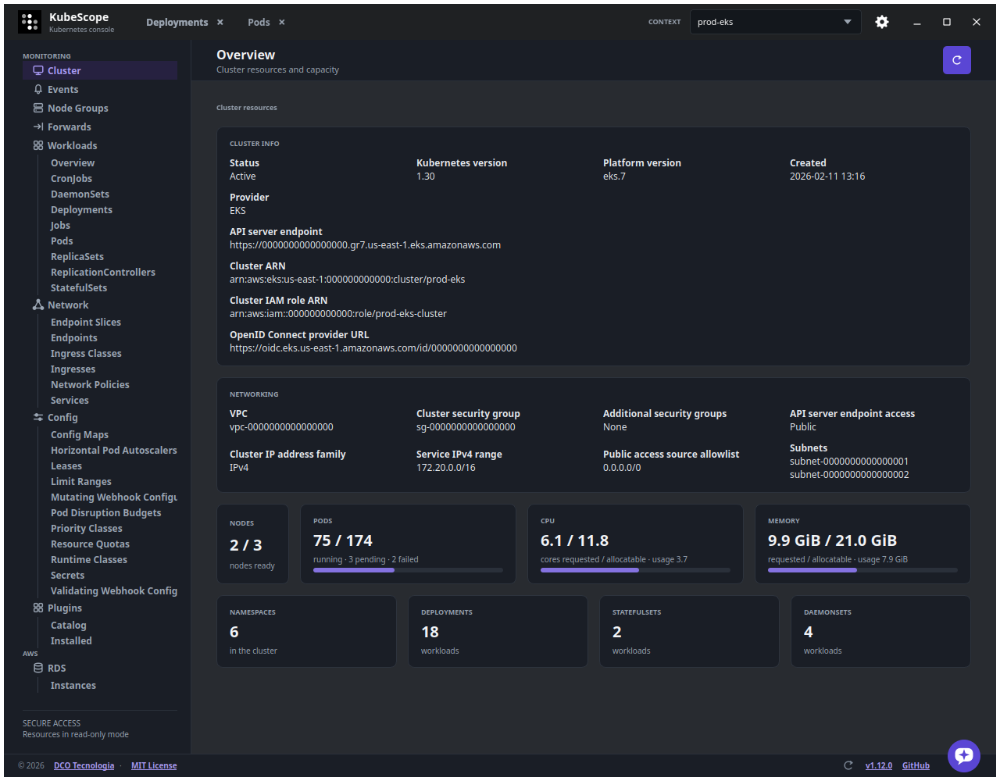
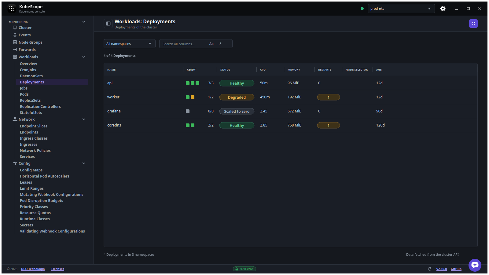
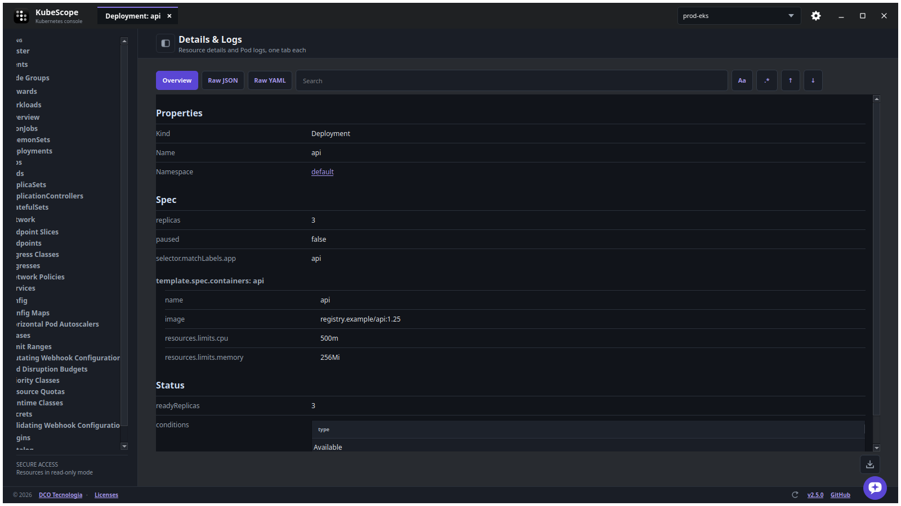
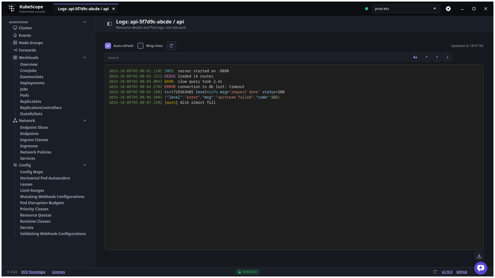

# KubeScope

[](https://github.com/dcotecnologia/kubescope/actions/workflows/ci.yml)
[](https://github.com/dcotecnologia/kubescope/actions/workflows/ci.yml)
[](LICENSE)
[](pyproject.toml)
[](https://doc.qt.io/qtforpython-6/)
[](#packaging)
[](https://docs.astral.sh/ruff/)
[](https://x.com/dcotecnologia)
[](https://www.instagram.com/dcotecnologia/)
[](https://www.facebook.com/dcotecnologia/)
[](https://www.linkedin.com/company/86377820/)
[](https://kubernetes.io/)

Desktop IDE for Kubernetes, including Amazon EKS, Google GKE and
Azure AKS clusters available
through the local Kubernetes configuration. It talks to the cluster with the
official Kubernetes Python client, so it needs no `kubectl`. It is read-only by
default: it lists and inspects resources. An optional **write mode** (off until
you turn it on in Settings) adds a few actions to the right-click menu: delete or
evict a Pod, scale or restart a Deployment (each asks for confirmation), and the
complete `kubectl exec` command to open a shell in a Pod and the `kubectl
port-forward` command of a Service, a Pod or a StatefulSet, to run in your own terminal.

Meet **Gabi**, the Kubernetes assistant built into KubeScope. Ask her why a Pod is
restarting, let her investigate the resource, logs and events, or have her take you
straight to the relevant screen. She uses Claude Code or Codex already signed in on
your computer, works in the app's language, and stays read-only unless you explicitly
turn on write mode and confirm a proposed action. [See what Gabi can do](#gabi-the-assistant).

## Install

The easiest way, and the one we recommend, is the install script. It finds the
latest release, picks the right package for your system, checks it against the
sha256 that GitHub publishes for it, and installs it. Run the same command again to
update.

**Linux** (the `.deb` on Debian and Ubuntu, the AppImage elsewhere):

```bash
curl -fsSL https://raw.githubusercontent.com/dcotecnologia/kubescope/main/install.sh | sh
```

**Windows** (PowerShell, for your user, no administrator needed):

```powershell
irm https://raw.githubusercontent.com/dcotecnologia/kubescope/main/install.ps1 | iex
```

To choose a version or look before it acts, save the script and run it with
`--dry-run` (`-DryRun` on Windows), `--version 0.1.0` (`-Version 0.1.0`) or
`--method appimage` (or `deb`, `rpm`, `arch`); `./install.sh --help` lists them. A script that you pipe into a
shell runs with your rights, so read it first if you prefer:
[install.sh](install.sh) and [install.ps1](install.ps1). The sha256 check catches a
damaged or swapped download; it trusts GitHub and this repository, as any download
from them does.

On macOS, download the zip for your Mac from the [latest release](https://github.com/dcotecnologia/kubescope/releases/latest) (see the table below).

### Install by hand

Download the package for your system from the
[latest release](https://github.com/dcotecnologia/kubescope/releases/latest). You do
not need `kubectl`.

| System                | Package                                     | How to install                                                                 |
| --------------------- | ------------------------------------------- | ------------------------------------------------------------------------------ |
| Debian and Ubuntu     | `kubescope_<version>_amd64.deb`             | `sudo apt install ./kubescope_<version>_amd64.deb`, then `kubescope`           |
| Fedora                | `kubescope-<version>-1.x86_64.rpm`          | `sudo dnf install ./kubescope-<version>-1.x86_64.rpm`, then `kubescope`        |
| Arch Linux            | `kubescope-<version>-1-x86_64.pkg.tar.zst`  | `sudo pacman -U kubescope-<version>-1-x86_64.pkg.tar.zst`, then `kubescope`    |
| Any Linux             | `KubeScope-<version>-x86_64.AppImage`       | `chmod +x` the file and run it                                                 |
| Windows               | `KubeScope-<version>-windows-x64-setup.exe` | run the installer; or unzip the portable `KubeScope-<version>-windows-x64.zip` |
| macOS (Apple silicon) | `KubeScope-<version>-macos-arm64.zip`       | unzip, then right-click `KubeScope.app` and choose Open (it is not signed)     |
| macOS (Intel)         | `KubeScope-<version>-macos-x86_64.zip`      | unzip, then right-click `KubeScope.app` and choose Open (it is not signed)     |
| Other systems         | none yet                                    | [run it from source](#run-from-source)                                         |

How to remove the app, and the details of each system, read the
[installation guide](https://github.com/dcotecnologia/kubescope/wiki/Installation)
on the wiki. To connect to your clusters, see
[Connecting to clusters](https://github.com/dcotecnologia/kubescope/wiki/Connecting-to-clusters).



_The cluster overview, shown with sample data. Regenerate it with
`make screenshot`, which also renders the ones below._



_The Deployments list, with the Pods, Details and Logs buttons._



_The JSON of a resource, colored._



_Pod logs with colored levels. These screens are drawn from fake data by
`make store-screenshots`, which also renders the other themes._

## Features

- **Extensions:** [Gabi](https://github.com/dcotecnologia/kubescope-ai-gabi), [AWS](https://github.com/dcotecnologia/kubescope-aws), [Custom Resources](https://github.com/dcotecnologia/kubescope-ext-custom-resources) and more, and your own,
  written against the [SDK](https://github.com/dcotecnologia/kubescope-sdk), installed from a folder or
  GitHub in **Settings → Extensions**. See [Extensions](#extensions).
- **Overview:** nodes ready, Pod counts, CPU and memory requests against capacity,
  and the number of namespaces, Deployments, StatefulSets and DaemonSets.
- **Workloads overview:** the first entry of the **Workloads** menu counts Pods,
  Deployments, DaemonSets, StatefulSets, ReplicaSets, Jobs and CronJobs with a
  health bar each (green healthy, orange coming up or degraded, red failing, grey
  idle) and lists the latest cluster events. Each count links to its list.
- **Workloads:** the same menu slides out **Pods**, **Deployments**,
  **StatefulSets**, **DaemonSets**, **ReplicaSets**, **ReplicationControllers**,
  **Jobs** and **CronJobs**.
  - The lists show CPU, memory and restarts next to the status, and can be
    filtered by namespace and searched by name.
  - CPU and memory are live usage from `metrics-server`; without it they show
    `—`. A workload's numbers are the sum of its Pods. Jobs show completions and
    a Complete, Running, Failed or Suspended status; CronJobs show their schedule.
  - In the Pods list, young Pods (under an hour) get a soft green row and Pods
    that are restarting, failing or not ready get a soft red one.
- **Network:** a second menu lists **Services**, **Endpoint Slices**, **Endpoints**,
  **Ingresses**, **Ingress Classes** and **Network Policies**, each with its own
  columns, and **Details** for the JSON of a row. The two menus open on their own,
  and the navigation scrolls when they do not fit.
- **Pinned lists:** double-click any entry of the Workloads, Network or Config
  menus (or right-click it and choose **Pin to the top**) to keep it as a tab in
  the top bar, like Lens, for quick access; middle-click the tab, or click its ×,
  to unpin. The choice is kept in
  `settings.json`.
- **Config:** a third menu lists **Config Maps**, **Secrets**, **Resource Quotas**,
  **Limit Ranges**, **Horizontal Pod Autoscalers**, **Pod Disruption Budgets**,
  **Priority Classes**, **Runtime Classes**, **Leases** and the **Mutating** and
  **Validating Webhook Configurations**. **Details** of a Secret shows its keys,
  never its values. The **Cluster Plugins** extension (recommended, not installed by itself) lists the Helm
  releases and the add-ons of the cluster with their versions and a catalog of Helm charts.
- **Cluster info (EKS only):** the Overview shows status, Kubernetes and platform
  versions, creation time, API server endpoint and the cluster and IAM role ARNs,
  and a **Networking** card with the VPC, subnets, security groups, endpoint access
  and service range.
- **Node Groups (EKS only):** a main-menu entry under Overview, shown only for
  Amazon EKS contexts. It lists the managed node groups with status, instance
  types, nodes (desired, min and max), AMI type and AMI version, read through the
  AWS CLI, with the cluster's nodes (status, role, version, CPU, memory, Pods) in
  the same view. It has no namespace filter, since node groups are not namespaced.
- **Details and logs:** JSON or YAML details of a Pod or workload, and live Pod logs,
  each in its own closable tab, colored like Monokai. **Save...** writes the open
  tab to a file you choose.
- **Gabi, the Kubernetes assistant:** ask about a workload in the round chat button,
  paste a screenshot, manifest or log, and she uses the cluster context to investigate
  it. She can explain evidence, open the right resource, list, log or overview, and
  prepare a write action only when write mode is on and you press **Run**. See
  [Gabi, the assistant](#gabi-the-assistant).
- **Update check:** when it starts, KubeScope asks GitHub for the latest release and shows **Update available** next to an icon in the footer. The icon spins
  while it looks, and clicking it checks again. It sends only the app version;
  **Settings** turns the startup check off. A stable installation is offered only
  stable releases, while an alpha, a beta or a release candidate is offered the next
  pre-release too, and the stable release that follows it. Clicking **Update available** asks you
  to confirm, shows the version change and the release notes, then updates the
  way KubeScope was installed (AppImage, `.deb` or the Windows installer) and
  restarts it. A source checkout opens the release page instead.
- **Your table, your way:** drag any column border to resize it, and right-click
  a table header to hide or show columns. The choice is remembered.
- **Readable errors:** a missing login tool, an unreachable cluster, expired
  credentials or denied access appear as a short message with a hint; the
  original error text stays one click away as details.
- **Sign-in check:** when you open an AWS context, KubeScope checks that you are
  signed in (SSO session or access keys). If not, a **Sign in to AWS** button
  runs `aws sso login` for the profile your kubeconfig uses and reloads the data.
  Access-key profiles get a **Configure AWS credentials** button that opens a
  terminal with `aws configure` for that profile. Google GKE and Azure AKS
  contexts get a **Sign in to Google Cloud** button (`gcloud auth login`) or a
  **Sign in to Azure** button (`az login`) when their credentials have expired.
- **Cloud integrations:** **Settings → Integrations** plugs the clusters of AWS
  (EKS), Azure (AKS) and Google Cloud (GKE), as many accounts of each as you
  like. Press **Add AWS account** (or Azure, or Google Cloud), pick an AWS profile
  of the AWS CLI or type the keys (for Google Cloud, pick the service account key
  file), press **Find clusters**, select the ones to add and press **Add
  clusters**. Each account shows in a table with a menu to find more clusters, to
  sign in again (AWS profiles) or to remove it. While an AWS account is plugged
  in, or an AWS SSO profile of the AWS CLI is signed in, the **AWS** extension (installed from **Settings → Extensions**) adds an **AWS** block
  with **RDS → Instances** to the side menu, a read-only list of the database instances of your AWS accounts. Secret keys stay in the memory of
  the app until it quits and are never written to a file, so type them again after
  a restart; the clusters go to a kubeconfig of KubeScope, apart from yours. It
  needs the cloud's command line program: `aws`, `az` with `kubelogin`, or
  `gcloud`.
- **Windows and lists rise into place** as they first show; **Settings** turns the
  animations off.
- **Always responsive:** every cluster call runs in the background, so the window
  never freezes while the cluster or the cloud CLIs work.
- **English, Portuguese, Spanish, Italian, French, German, Dutch, Polish, Turkish,
  Indonesian, Vietnamese, Ukrainian, Russian, Chinese (simplified and traditional),
  Japanese, Korean, Thai, Hebrew, Persian, Arabic and Hindi**,
  selectable in Settings, where each language is listed by its own name and its English
  name, in alphabetical order.

## Extensions

KubeScope stays small: a feature that is not for everyone is an **extension** that you install and
uninstall in **Settings → Extensions**, from a folder (pick its `kubescope-extension.toml`) or from a
GitHub repository. An extension is a Python project written against the
[KubeScope SDK](https://github.com/dcotecnologia/kubescope-sdk) and nothing else of the app.

| Extension | What it does | Installed |
| --------- | ------------ | --------- |
| [Gabi](https://github.com/dcotecnologia/kubescope-ai-gabi) | The AI assistant: ask about your cluster in the corner of the window or with `kubescope chat` | Comes with KubeScope, and can be uninstalled |
| [Global Search](https://github.com/dcotecnologia/kubescope-search) | Press `/` or `Ctrl+K` to find a screen, a list or a resource by its name | Comes with KubeScope, and can be uninstalled |
| [Themes](https://github.com/dcotecnologia/kubescope-themes) | Thirteen color themes, light and dark | Comes with KubeScope, and can be uninstalled |
| [AWS](https://github.com/dcotecnologia/kubescope-aws) | The RDS databases of the account of the selected cluster, with details, logs and a port forward | Recommended (★), you install it |
| [Notifications](https://github.com/dcotecnologia/kubescope-notifications) | A bell with the Warning and Error events of every context, in a panel | Recommended (★), you install it |
| [Custom Resources](https://github.com/dcotecnologia/kubescope-ext-custom-resources) | The custom resources of the cluster by API group, as Lens has them, and a resync of the ExternalSecrets | Recommended (★), you install it |

The same list, with what each one asks for, is on the [Extensions page](https://kubescope.dcotecnologia.com/extensions/).

The table of **Settings → Extensions** lists what is installed and what KubeScope recommends, with the
installed or latest available version, the author, when it was installed and last updated, and where it
came from; double-click a row for its details and right-click it to install, update, reinstall or uninstall.
KubeScope looks for newer versions and suggests them, and never updates one by itself. Before anything of
an extension runs, a dialog shows where it comes from, its permissions and the sha256 of its content.

To write one, read the guides of the SDK:
[getting started](https://github.com/dcotecnologia/kubescope-sdk/blob/main/docs/getting-started.md),
[the manifest](https://github.com/dcotecnologia/kubescope-sdk/blob/main/docs/manifest.md),
[the context](https://github.com/dcotecnologia/kubescope-sdk/blob/main/docs/api.md),
[contributions](https://github.com/dcotecnologia/kubescope-sdk/blob/main/docs/contributions.md) and
[permissions and security](https://github.com/dcotecnologia/kubescope-sdk/blob/main/docs/permissions.md).
An extension is code that runs with your permissions: install only the ones you trust (see
[SECURITY.md](SECURITY.md)).

## Gabi, the assistant

Gabi is an AI assistant for KubeScope, made by DCO Tecnologia. She is
[an extension of her own project](https://github.com/dcotecnologia/kubescope-ai-gabi) that comes installed. She knows Kubernetes
and KubeScope, and she only talks about them: she politely declines anything else.
She answers in the language of the app, in any of its 21 languages, unless you write
to her in another one. Open the round button and ask a practical question such as
“why is this Pod restarting?”, “show me the errors from the last hour” or “where is
this Deployment configured?”

### How it works

Gabi does not run on a server of KubeScope. She runs on a coding assistant that is
**already installed and signed in on your computer**: [Claude Code](https://claude.com/claude-code)
(`claude`) or [Codex](https://github.com/openai/codex) (`codex`). KubeScope hands that
program your question and shows its answer. It asks you for no credentials and stores
none: the sign-in stays with the program.

The program is started so that it can only answer, not act: Claude Code with no tools
and Codex with its shell, file viewing, plugins, browser and web search switched off,
both without a saved session. Gabi cannot read a file of your computer or run a command.

### Set it up

1. Install and sign in to Claude Code or Codex, as you would to use them in a terminal.
2. Open the round button in the corner of the window and, the first time, agree that
   what you ask and what she reads from the cluster go to that program and to its
   service. Nothing is sent before that.
3. In **Settings → Gabi**, the section turns the button on or off, picks the program
   (**Automatic** uses the first one it finds) and, if the system does not find a
   program on its path, takes the path of it, which you can type or browse for.

The button is there even before any of this. If KubeScope finds neither program, it
opens a short guide with what to install, an **Open Settings** button that takes you
to the card where the path is told, and a link to these instructions.

### What she can do

- **See what you see.** With each question she gets a description of the window: the
  list and its rows, the selected row, the namespace and the search, the text of the
  open Details or Logs, the numbers of the overviews and the tabs you have open.
- **Look into a problem.** She reads the details of a resource, the logs of a Pod, the
  lists and the events of a namespace, up to five reads for a question, and tells you
  what she checked, what the evidence shows and how sure she is.
- **Take you there.** She changes the window as you would with a click: a list, the
  Cluster or Workloads overview, Settings, a namespace, a context, a search, the details
  of a resource, the logs of a Pod or a tab that is open.
- **Propose a change.** Only with the **write mode** on: scale or restart a Deployment,
  evict or delete a Pod, delete or replace a resource. A change is never done by her. It
  appears as a card with the exact action and **Run** or **Cancel**, and runs through the
  same code and limits as the buttons of the write mode.
- **Work from the evidence you provide.** Attach a screenshot, manifest or text file,
  or paste an image into the chat; she combines it with the context you allow her to
  read and keeps the answer focused on the cluster.

In the default **read-only mode** she cannot edit, update or delete anything, she is not
even told that those actions exist, and she says so plainly when you ask. She may still
explain a change and show the command or YAML for you to review and run yourself.

### Using the chat

- The panel opens over the button. Drag its left edge, top edge or corner to resize it,
  or take it out into a window of its own with the button of its header. Its size and
  place are kept.
- **+** attaches images (up to 5 MiB) and text files such as logs and manifests (up to
  200 KiB), four at most for a question; a picture can also be pasted into the field.
  Images need a program that takes them, which both do.
- Conversations are kept on your computer for each context, without the documents, logs
  and files that were read or attached. **Clear history** forgets one context, and
  **Settings** forgets them all.

### What leaves your computer

What you type and attach, a description of the window, and what Gabi asks the app to
read: resource documents (Secret values are hidden), the last lines of a log, lists and
events. Tokens and keys are redacted, but a password an application prints inside a
sentence of a log can still go, so be careful on a cluster whose logs hold secrets.
[SECURITY.md](SECURITY.md) has the whole account.

She is an AI and can be wrong: read the commands she suggests before you run them.

## Requirements

- Python 3.15 to run from source
- Linux Mint/Ubuntu: `apt-get` and `dpkg-deb` to stage the Qt XCB runtime library
- For contexts whose kubeconfig signs in with an `exec` credential plugin: the
  AWS CLI (EKS), `gke-gcloud-auth-plugin` and the Google Cloud CLI (GKE), or
  `kubelogin` and the Azure CLI (AKS), and valid credentials for them
- Read access to namespaces, pods, events, deployments, statefulsets, daemonsets,
  replicasets, replicationcontrollers, jobs, and cronjobs; for the Network menu,
  also services, endpoints, endpointslices, ingresses, ingressclasses, and
  networkpolicies; for the Config menu, also configmaps, secrets, resourcequotas,
  limitranges, horizontalpodautoscalers, poddisruptionbudgets, priorityclasses,
  runtimeclasses, leases, and the mutating and validating webhook configurations
- Optional, for the cluster overview page: read access to nodes and pods across
  namespaces. Optional, for CPU and memory in the Pods and Deployments lists and
  on the overview: `metrics-server` for real usage. Sections the role
  cannot read are reported on the page instead of failing it

## Run from source

```bash
make setup                      # uv sync with the dev and build extras
uv run pre-commit install       # run the checks on every commit
make run
```

`make run` stages `libxcb-cursor.so.0` locally on Linux and adds it to the
runtime library path. This avoids installing `libxcb-cursor0` system-wide. On
non-Linux systems, the target starts the app without the Linux-specific library.

`make debug` runs the app with debug logging on stderr (`KUBESCOPE_DEBUG=1`),
Python dev mode and Qt platform-plugin tracing. Nothing is written to disk.

The app reads contexts from the default kubeconfig (`~/.kube/config` or the path
in `KUBECONFIG`). Unless you turn on the write mode it only reads cluster
resources, so configure a read-only Kubernetes role for the contexts used by the
app. The write mode needs more rights, listed in the wiki.

## Build a bundled application

Build on each target operating system and architecture. PyInstaller includes the
Python dependencies, among them the Kubernetes client, in the application bundle.

```bash
python -m pip install -e '.[build]'
python tools/fetch_linux_qt_libs.py  # Linux only
pyinstaller --noconfirm KubeScope.spec
```

The distributable application is created under `dist/KubeScope/`.

## Debug log

**Settings > Debug mode** writes a log file you can share when something goes
wrong: the commands the app ran, how long they took and how they ended, never Pod
logs or resource contents, with tokens and keys scrubbed. **Open the log folder**
jumps to it (`logs/` next to `settings.json`). The file rotates and stays small.
`make debug` also prints the log to the terminal. See [SECURITY.md](SECURITY.md)
for exactly what is recorded.

## Settings, themes and languages

The **Settings** page (sidebar) stores preferences as JSON in
`~/.config/kubescope/settings.json` (`%APPDATA%\\kubescope` on Windows,
`~/Library/Application Support/kubescope` on macOS; override with
`KUBESCOPE_CONFIG_DIR`). It lets you pick the language, the theme, remember the last context, and give each kubeconfig
context a friendlier display name. The real context name is still used for every
request. Hidden table columns are stored in the same file.

### Themes

KubeScope ships a **Light** and a **Dark** theme, and you can make your own. In
Settings, **New theme...** opens an editor that starts from the selected theme: give
it a name, pick a color for each part of the interface (page, panels, top bar,
accent, status colors, and more) and save. **Edit theme...** changes one of your
themes (its **Reset** button undoes the color changes since the editor opened),
and the window follows at once when it is the one in use. **Delete theme...**
removes one you made after asking (the themes that come with the app
cannot be deleted); if it was in use, the Dark theme comes back.

A theme is a small JSON file in the `themes/` folder next to `settings.json` (the
**Open the themes folder** button jumps there), so you can also edit or share it by
hand. It starts from a base theme and lists only the colors it changes:

```json
{
  "name": "Midnight",
  "base": "dark",
  "colors": { "page": "#0b0f14", "accent": "#7aa2f7", "topbar": "#000000" }
}
```

The color names are the ones the editor shows (`page`, `surface`, `text`, `accent`,
`topbar`, `good`, `bad`, ...; see `ROLES` in `src/kubescope/theme.py`). A file that
is damaged or uses an unknown name is skipped and noted in the debug log.

Light and Dark are built into the app (`src/kubescope/themes/light.json` and `dark.json`). The other
themes (Midnight, High Contrast, Sepia, Dark Modern, Light Modern, Solarized Dark and Light, Monokai, Tomorrow
Night Blue, Abyss, Quiet Light and the macOS ones) are the extension
[`kubescope-themes`](https://github.com/dcotecnologia/kubescope-themes), which comes with the app and can be
uninstalled in **Settings → Extensions**; they show in **Settings → Theme** with yours and cannot be deleted
from there. An extension of your own can offer themes too (`ctx.add_theme` of the
[SDK](https://github.com/dcotecnologia/kubescope-sdk)). To share a theme, open a pull request on that
repository (its README has the steps).

### Languages

KubeScope speaks **English**, **Portuguese** (`pt`), **Spanish** (`es`), **Italian** (`it`),
**French** (`fr`), **Chinese** (`zh`, simplified), **Japanese** (`ja`), **Arabic** (`ar`,
written right to left: the whole layout mirrors), **Hindi** (`hi`), **Russian** (`ru`), **Korean** (`ko`), **German** (`de`), **Turkish**
(`tr`), **Indonesian** (`id`), **Polish** (`pl`), **Vietnamese** (`vi`), **Dutch** (`nl`),
**Ukrainian** (`uk`), **Thai** (`th`), **Chinese (traditional)** (`zh_TW`, also used for
Hong Kong and Macau) and **Hebrew** (`he`) and **Persian** (`fa`), which are written right
to left like Arabic. **Automatic** (the default) follows
your system language and falls back to English. The texts in the code are English;
each other language is a JSON file, `src/kubescope/languages/<code>.json`: a name, whether
it is written right to left, and each English text with its translation. To add a
language without changing the app, or to change a shipped one, put a file of the same
format, named by the language code (`de.json`), in the `languages` folder of your
settings (`~/.config/kubescope/languages` on Linux); it becomes a choice in Settings
after a restart, and a file there wins over the shipped one of the same code.

## Contribute a theme or a language

Both are welcome as pull requests; `make test` checks them, and
[CONTRIBUTING.md](CONTRIBUTING.md) has the general workflow.

### Add a theme

1. In KubeScope, **Settings > New theme...**, pick your colors and save.
2. Copy the file from your themes folder (**Open the themes folder**) into
   `src/kubescope/themes/`, with a short lowercase name such as
   `my-theme.json`.
3. Run `make test`. It checks that every shared theme is valid, uses known color names
   and keeps its text readable (a 4.5:1 contrast between text and page).
4. Open a pull request, ideally with a screenshot. Once merged, the theme ships with
   the app and installs itself in everyone's themes folder.

### Add a language

1. `make language CODE=es NAME=Español` creates `src/kubescope/languages/es.json` with
   every text to translate, each with an empty translation. Use the two-letter
   language code and name the language in itself (add `RTL=1` for one written right
   to left).
2. Fill in the translations in any text editor. Keep the `{placeholders}` as they are.
3. `make test` fails while any text is untranslated (empty).
4. Open a pull request. To fix or improve an existing translation, edit its JSON.

New texts in the code are wrapped in `self.tr(...)`; after adding or changing some, run
`make i18n` to add them to every language file, untranslated, and complete the
translations.

## Packaging

```bash
make build      # PyInstaller bundle in dist/KubeScope
make deb        # dist/kubescope_<version>_amd64.deb (Debian/Ubuntu)
make rpm        # dist/kubescope-<version>-1.<arch>.rpm (Fedora; needs rpmbuild)
make arch       # dist/kubescope-<version>-1-<arch>.pkg.tar.zst (Arch Linux; needs zstd)
make appimage   # dist/KubeScope-<version>-x86_64.AppImage (any Linux with glibc)
```

Each of these packages the bundle in `dist/KubeScope`, so build one platform at a
time.

The **Release** workflow
(`.github/workflows/release.yml`) builds everything on GitHub runners: the Linux
`.deb` and AppImage on Ubuntu 22.04 (lower glibc requirement) and the Windows
installer plus a portable zip on Windows. Run it from the Actions tab, or push a
`v*` tag to also publish a GitHub release.

## Editing the UI

The screens are Qt Designer files in `src/kubescope/ui/`:

```bash
make designer   # open the .ui files in Qt Designer
make ui         # regenerate ui_*.py after saving (commit both)
make preview    # open the app with fake data, no cluster needed
```

### Qt Creator

Open the project with **File > Open File or Project** and pick
`KubeScope.pyproject`, which lists the project files. Under **Projects > Run**,
choose `main.py` as the script and `.venv/bin/python` as the interpreter.
`main.py` loads the staged Qt library itself, so no `LD_LIBRARY_PATH` is needed;
run `make qt-libs` once on Linux. Qt Creator keeps its per-user settings in
`*.pyproject.user`, which git ignores. When you add a source or `.ui` file, add
it to the list in `KubeScope.pyproject` too.

Widget `objectName`s are used by the style sheet and by `window.py`, so keep
them when renaming or moving widgets.

## Contributing and security

Read [CODE_OF_CONDUCT.md](CODE_OF_CONDUCT.md) and [CONTRIBUTING.md](CONTRIBUTING.md) before opening a pull request, and
[COMMITING.md](COMMITING.md) for the commit message format. [AGENTS.md](AGENTS.md)
holds the architecture and standards that people and AI assistants follow.
To write an extension, start with the [SDK](https://github.com/dcotecnologia/kubescope-sdk); each of
[the SDK](https://github.com/dcotecnologia/kubescope-sdk/blob/main/CONTRIBUTING.md),
[Gabi](https://github.com/dcotecnologia/kubescope-ai-gabi/blob/main/CONTRIBUTING.md) and
[AWS](https://github.com/dcotecnologia/kubescope-aws/blob/main/CONTRIBUTING.md) has its own contributing guide.
Report vulnerabilities privately as described in [SECURITY.md](SECURITY.md).

If something in KubeScope is hard to use with a keyboard, a screen reader or another assistive technology,
[ACCESSIBILITY.md](ACCESSIBILITY.md) says what we know and how to report it.

## Qt and the LGPL

KubeScope is built with Qt for Python (PySide6) and Qt, which are used under the
[GNU Lesser General Public License, version 3](packaging/licenses/LGPL-3.0.txt). KubeScope
does not change the code of Qt, and the license of KubeScope (MIT) does not limit what the
LGPL gives you:

- **The license texts** (the LGPL-3.0 and the GPL-3.0 it refers to) are in the
  `licenses` folder of every package, and in
  [THIRD_PARTY_NOTICES.txt](src/kubescope/assets/THIRD_PARTY_NOTICES.txt), which every
  package carries and the **Third-party notices** button of the **About** box opens.
- **The source code** of the Qt and Qt for Python versions that ship with a release is
  linked from that file; if you cannot get it from there, ask in the
  [issues](https://github.com/dcotecnologia/kubescope/issues) and it is sent to you.
- **You can replace the Qt libraries** with your own build of the same Qt version: they are
  separate shared libraries (in `_internal/PySide6/` of the application), not linked into
  the program, and KubeScope does not check them. The notices say where they are in each
  package (`.deb`, Windows, AppImage, tarball, macOS, pip).
- **Only the LGPL parts of Qt are shipped**: the Qt modules that are GPL-only (Virtual
  Keyboard, Charts, Data Visualization) are left out of the packages.

## Author

Danilo Carolino <danilogcarolino@gmail.com>

---

Developed by **DCO Tecnologia** · Released under the [MIT License](LICENSE).
The licenses of the libraries it ships with (Qt for Python under the LGPL-3.0, the
Kubernetes client under Apache-2.0, the Noto fonts under the OFL and the others) are in
[THIRD_PARTY_NOTICES.txt](src/kubescope/assets/THIRD_PARTY_NOTICES.txt), which every
package carries.
